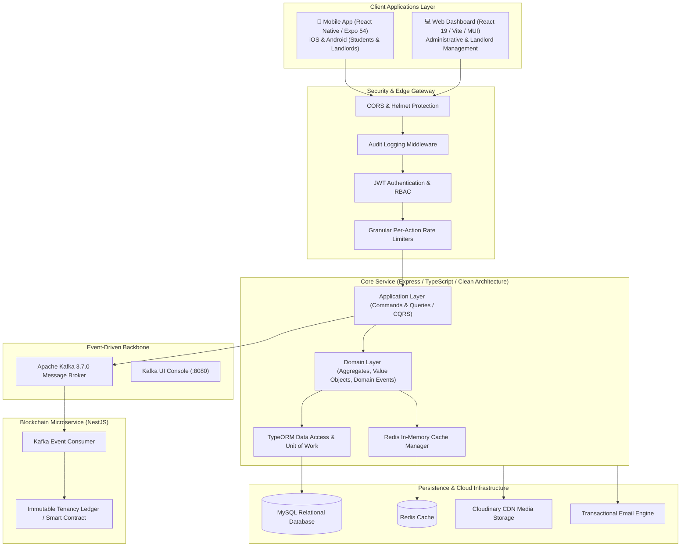
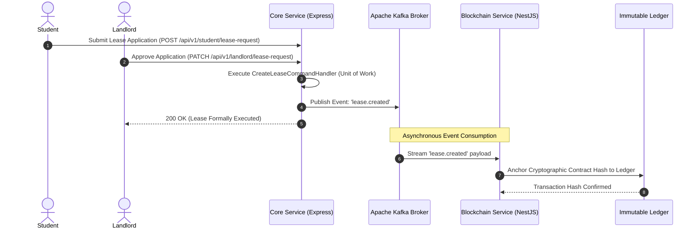

<div align="center">

# 🎓 Student Nest
### Decentralized Student Housing, Verified Tenancy & Roommate Matching Ecosystem

**A Bachelor of Science in Software Engineering Graduation Thesis**  
*Faculty of Information Technology — Department of Software Engineering*  
**Middle East University (MEU)**

[](https://www.typescriptlang.org/)
[](https://nodejs.org/)
[](https://expressjs.com/)
[](https://nestjs.com/)
[](https://reactnative.dev/)
[](https://expo.dev/)
[](https://react.dev/)
[](https://kafka.apache.org/)
[](https://www.mysql.com/)
[](https://redis.io/)
[](https://www.docker.com/)
[](https://snyk.io/)
[](https://github.com/AhmedAldhahi/Student-Nest/actions/workflows/ci.yml)

<p align="center">
  <a href="#-thesis-abstract">Thesis Abstract</a> •
  <a href="#-system-architecture">System Architecture</a> •
  <a href="#-software-engineering-design-patterns">Design Patterns</a> •
  <a href="#-domain-driven-design-bounded-contexts">Domain Models</a> •
  <a href="#-event-driven-pipeline--blockchain">Event Streaming</a> •
  <a href="#-roommate-matching-algorithm">Roommate Algorithm</a> •
  <a href="#-quickstart-guide">Quickstart</a> •
  <a href="#-academic-attribution">Attribution</a>
</p>

---

</div>

## 📖 Thesis Abstract

Finding safe, affordable, and compatible student housing is one of the most critical challenges facing university students worldwide. The traditional off-campus rental ecosystem is plagued by **information asymmetry, fake listings, fraudulent deposit schemes, arbitrary contract modifications**, and **acute roommate friction** caused by mismatched lifestyle habits.

**Student Nest** addresses these systemic challenges through an enterprise-grade, distributed software system designed according to strict **Domain-Driven Design (DDD)** and **Clean Architecture** principles. Key engineering contributions include:

1. **Decentralized Trust & Immutable Leases:** Combining event-driven architecture (**Apache Kafka**) with a dedicated **Blockchain Microservice** to record cryptographic hashes of finalized tenancy agreements onto an immutable ledger, ensuring dispute settlement auditing and non-repudiation.
2. **Academic & KYC Identity Verification:** Multi-role identity pipelines verifying university credentials, student cards, and landlord property title deeds before transactions take place.
3. **Algorithmic Roommate Matching:** A weighted Euclidean vector compatibility algorithm evaluating multi-dimensional lifestyle habits (sleep cycles, study noise tolerance, guest policies, pet preferences, and dietary restrictions) to maximize roommate harmony.
4. **Defense-in-Depth Security:** Granular action-specific rate limiting, role-based access control (RBAC), tamper-evident audit logging, and automated dependency security scans (**Snyk**).

---

## 🏛️ System Architecture

Student Nest is structured as a modern distributed microservices ecosystem:



For the comprehensive Software Architecture Document, see [**docs/architecture/system-design.md**](docs/architecture/system-design.md).

---

## 📐 Software Engineering Design Patterns

The codebase serves as a reference implementation for classic and modern software engineering patterns:

| Pattern | Category | Implementation Location | Purpose & Value in Thesis |
|---|---|---|---|
| **Strategy Pattern** | Behavioral | `Application/BoundedContexts/Shared/Strategy/` | Encapsulates role-dependent logic (`Student`, `Landlord`, `Admin`, `Guest`) across Payment, Apartment, Lease, Lease Request, Profile, and Notification domains without conditional pollution. |
| **Simple Factory** | Creational | `Application/BoundedContexts/Shared/SimpleFactory/` | Decouples caller logic from dynamic query handler instantiation (`GetUserQuerySimpleFactory.ts`, `GetUsersSimpleFactory.ts`). |
| **Unit of Work** | Architectural | `Infrastructure/Repositories/unitOfWork.repositories.ts` | Guarantees atomic transaction boundaries across multiple repository writes during lease creation and payment processing. |
| **Repository Pattern** | Architectural | `Infrastructure/Repositories/Read/` & `Write/` | Segregates read and write operations (CQRS) and abstracts data persistence details from the business domain. |
| **Observer / Pub-Sub** | Behavioral | `Domain/Shared/Event/DomainEventDispatcher.ts` | Decouples state changes in aggregates from cross-cutting concerns (notifications, cache invalidation, and Kafka streaming). |
| **Singleton Pattern** | Creational | `Infrastructure/Services/messagine/KafkaMessageBroker.service.ts` | Maintains a single, thread-safe Kafka producer connection pool across the application lifecycle. |
| **Chain of Responsibility** | Behavioral | `Presentation/http/middlewares/` | Composes authentication, RBAC, tamper-evident audit logging, and sliding-window rate limiters into a linear request processing pipeline. |
| **Value Object Pattern** | DDD | `Domain/.../Value-Object/` | Implements immutable, self-validating domain primitives (`ApartmentPrice`, `OTP`, `StudentCard`, `UserGovId`, `RentTerm`, `AgeValue`). |

For UML diagrams and in-depth code walkthroughs, see [**docs/architecture/design-patterns.md**](docs/architecture/design-patterns.md).

---

## 🧩 Domain-Driven Design (DDD) Bounded Contexts

The core domain is partitioned into 7 cohesive Bounded Contexts:

```
src/Domain/BoundedContexts/
├── IdentityAndAccess/   # StudentAggregateRoot, landloardAggregateRoot, UserEntity, KYC, OTP
├── Housing/             # apartmentEntity, apartmentDocumentEntity, GoogleMapLocation, Cloudinary
├── Leases/              # leaseEntity, leaseRequestEntity, RentTerm, LeaseStatus state machine
├── Payment/             # Payment.AgregateRoot, ReceiptEntities, PaymentAmount, verification
├── RommateProfile/      # RommateProfile, LifeCycleHabbitEntity, Habit enums, Matching queries
├── Notifications/       # NotificationEntity, multi-channel event dispatching
└── adminstration/       # auditlogEntity, administrative actions, system compliance logs
```

---

## ⚡ Event-Driven Pipeline & Blockchain

To combine low-latency client experiences with the immutability of distributed ledgers, tenancy contracts follow an asynchronous event-driven lifecycle:



For topic topologies and consumer configurations, see [**docs/architecture/event-driven-pipeline.md**](docs/architecture/event-driven-pipeline.md).

---

## 🤝 Roommate Matching Algorithm

Student Nest features an algorithmic compatibility engine that compares normalized lifestyle habit vectors $\vec{v}_A$ and $\vec{v}_B$:

$$\text{Compatibility}(A, B) = 100 \times \left(1 - \sqrt{\sum_{i=1}^{n} w_i \cdot \left( \frac{\text{dist}(A_i, B_i)}{\text{max\_dist}_i} \right)^2}\right)$$

- **Zero-Tolerance Filters:** Automatic disqualification if critical constraints fail (e.g., gender preferences or strict indoor non-smoking).
- **Weighted Multi-Dimensional Scoring:** Evaluates sleep schedule ($0.20$), noise tolerance ($0.15$), smoking habits ($0.20$), pet preferences ($0.10$), guest policies ($0.10$), sharing preferences ($0.10$), dietary needs ($0.05$), and language preferences ($0.05$).

For mathematical proofs and query handler details, see [**docs/architecture/roommate-matching-algorithm.md**](docs/architecture/roommate-matching-algorithm.md).

---

## 📂 Repository Directory Structure

```
Student-Nest/
├── .github/workflows/          # GitHub Actions CI/CD Pipeline (Build, Lint, Test)
├── docs/                       # Academic & Technical Documentation Hub
│   └── architecture/           # System Architecture, Design Patterns, Math Models
├── backend/
│   ├── README.md               # Backend ecosystem overview
│   └── service/
│       ├── core-service/       # Express + TypeScript + Clean Architecture + DDD Core
│       │   ├── src/            # Domain, Application, Infrastructure, Presentation layers
│       │   ├── test/           # Unit, integration, security audit & test reports
│       │   ├── docker-compose.yml  # Apache Kafka 3.7.0 & Kafka UI container stack
│       │   └── README.MD       # Core service technical documentation
│       └── blockchain-service/ # NestJS microservice for decentralized lease immutability
│           └── README.md       # Blockchain microservice guide
└── frontend/
    ├── mobile/                 # Cross-platform mobile client (React Native / Expo 54)
    │   ├── student-nest/       # Source code, navigation, features, map views
    │   └── README.MD           # Mobile application documentation
    └── web/                    # Administrative & Landlord web portal (React 19 / Vite 6 / MUI)
        └── README.MD           # Web portal documentation
```

---

## 🚀 Quickstart Guide

### Prerequisites
- [Node.js (v20+)](https://nodejs.org/)
- [Docker & Docker Compose](https://www.docker.com/)
- [pnpm](https://pnpm.io/) and `npm`

### 1. Launch Kafka & Event Streaming Stack
```bash
cd backend/service/core-service
docker compose up -d
```
*Access the Kafka UI Console at `http://localhost:8080`.*

### 2. Start the Backend Core Service
```bash
cd backend/service/core-service
npm install
npm run dev
```
*The Core API will run on `http://localhost:4000`.*

### 3. Start the Blockchain Microservice
```bash
cd backend/service/blockchain-service
pnpm install
pnpm start:dev
```

### 4. Run the Mobile Application (React Native / Expo)
```bash
cd frontend/mobile/student-nest
npm install
npx expo start
```
*Scan the generated QR code using Expo Go on Android or iOS.*

### 5. Run the Web Management Portal
```bash
cd frontend/web
npm install
npm run dev
```
*Access the Web Dashboard at `http://localhost:5173`.*

---

## 🧪 Testing & Security Audits

The project incorporates rigorous quality control and security scanning:

- **Automated Unit Tests:** Covering Domain Aggregates, Entities, and Value Objects.
- **HTML Test Reports:** Detailed Jest test execution summary available at [`test/backend/unit/AggregateRoot/test-report.html`](backend/service/core-service/test/backend/unit/AggregateRoot/test-report.html).
- **Snyk Vulnerability Scan:** Security audit report available at [`test/backend/security/Snyk/snyk-report.html`](backend/service/core-service/test/backend/security/Snyk/snyk-report.html).
- **Continuous Integration (CI):** Automated GitHub Actions pipeline validating compilation and linting on every commit.

```bash
# Run backend unit tests
cd backend/service/core-service
npm test
```

---

## 🎓 Academic Attribution

- **Project Title:** Student Nest: Decentralized Student Housing, Lease Management & Roommate Matching Platform
- **Degree:** Bachelor of Science in Software Engineering (B.Sc. SE)
- **Department:** Department of Software Engineering — Faculty of Information Technology
- **Institution:** **Middle East University (MEU)**, Amman, Jordan
- **Academic Year:** 2025 – 2026

---

<div align="center">
  <sub>Developed for academic excellence and software engineering leadership at Middle East University.</sub>
</div>
