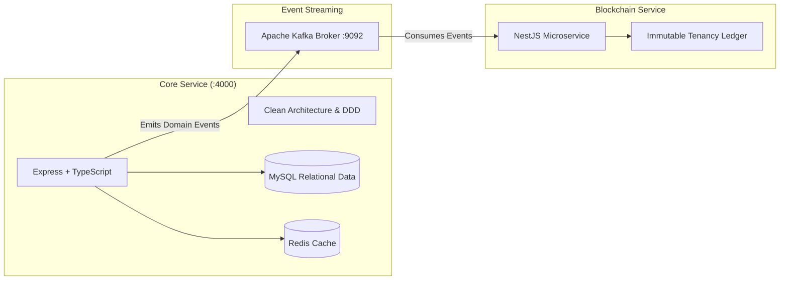

# Student Nest — Backend Microservices Ecosystem

**Project:** Student Nest (Bachelor of Science in Software Engineering Thesis)  
**Institution:** Middle East University (MEU) — Faculty of Information Technology  
**Department:** Software Engineering  

---

## Architecture Overview
The backend is architected as an event-driven distributed system comprising two primary decoupled services communicating via **Apache Kafka**:



---

## Directory Structure & Services

| Service | Technology | Role | Port / Protocol |
|---|---|---|---|
| [`core-service`](file:///c:/Users/Ahmed/Desktop/projects/Student-Nest/student/Student-Nest/backend/service/core-service/) | Node.js, Express, TypeORM, TypeScript | Core business logic, CQRS, user auth, apartment inventory, roommate matching, payments. | `4000` (HTTP / REST) |
| [`blockchain-service`](file:///c:/Users/Ahmed/Desktop/projects/Student-Nest/student/Student-Nest/backend/service/blockchain-service/) | NestJS, KafkaJS, RxJS | Decentralized lease verification, event consumer, immutable audit logs. | Kafka Consumer |

---

## Getting Started

### 1. Launch Infrastructure via Docker Compose
From `backend/service/core-service`:
```bash
docker compose up -d
```
This spins up:
- **Apache Kafka 3.7.0** on `localhost:9092`
- **Kafka-UI** console on `http://localhost:8080`

### 2. Environment Variables & Core Service
Configure `.env` in `backend/service/core-service` and run:
```bash
cd service/core-service
npm install
npm run dev
```

For detailed layer documentation, refer to [`core-service/README.md`](file:///c:/Users/Ahmed/Desktop/projects/Student-Nest/student/Student-Nest/backend/service/core-service/README.MD).
