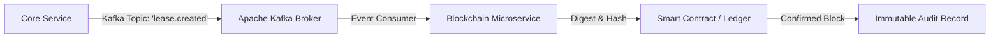

# Student Nest — Blockchain Microservice

**Technology:** NestJS, Apache Kafka (`kafkajs`), RxJS, TypeScript  
**Role:** Decentralized Tenancy Ledger & Event Consumer  
**Academic Thesis:** Bachelor of Science in Software Engineering, Middle East University (MEU)  

---

## 1. Role in System
The **Blockchain Service** acts as an autonomous microservice responsible for:
1. **Consuming Domain Events:** Listening to event topics emitted by the Core Service over Apache Kafka (e.g., `lease.created`, `payment.verified`, `contract.signed`).
2. **Anchoring Immutable Records:** Generating cryptographic signatures/hashes of tenancy contracts and writing them to an immutable ledger or smart contract.
3. **Dispute Resolution Auditing:** Providing verifiable proofs of agreement without exposing raw personal identity data.

---

## 2. Architecture & Messaging Pipeline



---

## 3. Technology Stack
- **NestJS Framework:** Enterprise modular architecture with Dependency Injection.
- **`@nestjs/microservices`:** Built-in microservice abstraction providing high-performance Kafka transports.
- **KafkaJS:** Robust, pure TypeScript Kafka client driver.
- **ESLint & Prettier:** Strictly enforced code style and linting standards.

---

## 4. Getting Started

### 1. Prerequisites
Ensure the Kafka broker is running (via `backend/service/core-service/docker-compose.yml`):
```bash
# Verify Kafka is running
docker ps | grep kafka
```

### 2. Run the Service
```bash
# Install dependencies using pnpm
pnpm install

# Start in development mode with hot-reload
pnpm start:dev

# Run tests
pnpm test
```
