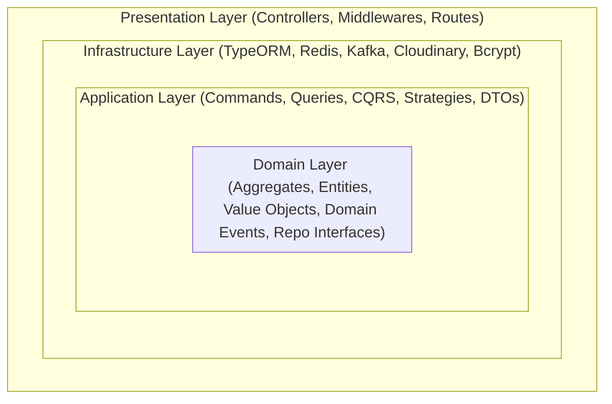
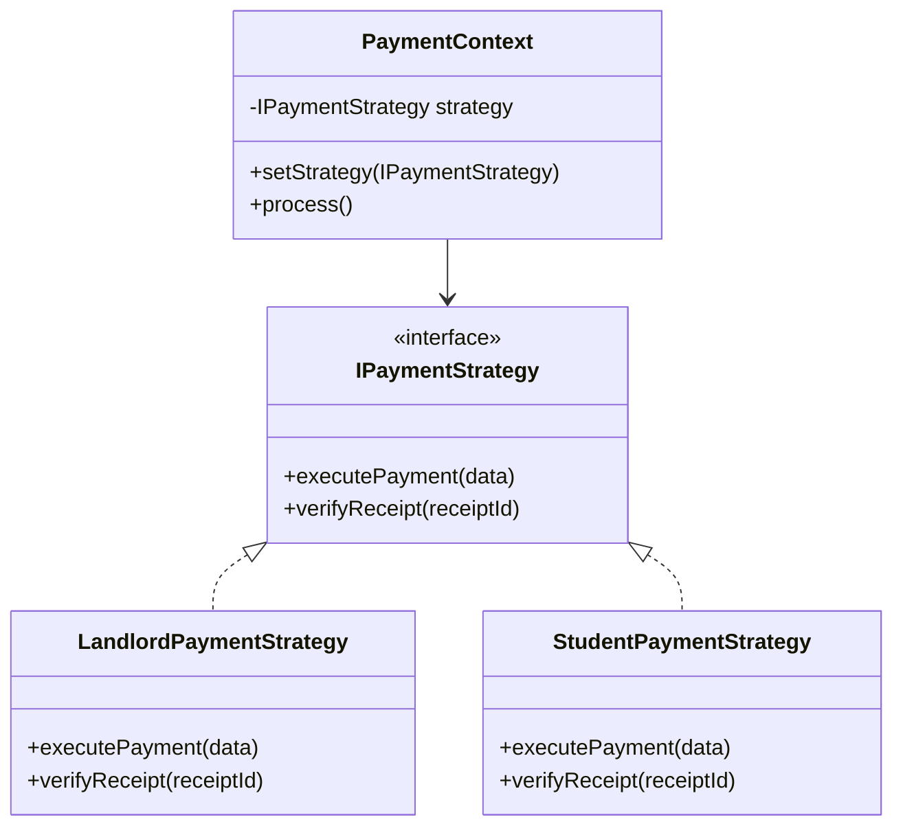
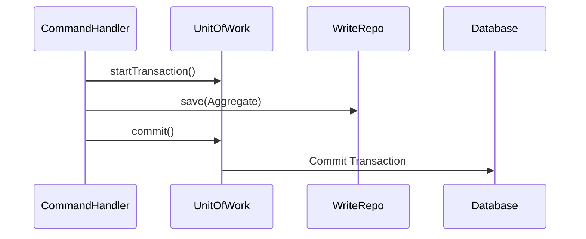

# Software Engineering Design Patterns in Student Nest

**Project:** Student Nest (Bachelor of Science in Software Engineering Thesis)  
**Institution:** Middle East University (MEU) — Faculty of Information Technology  
**Department:** Software Engineering  

---

## 1. Architectural Patterns

### 1.1 Clean / Hexagonal Architecture (Ports and Adapters)
The backend core service strictly separates business logic from technical concerns across four concentric rings:



- **Dependency Inversion Principle (DIP):** The inner `Domain` layer has zero dependencies on external libraries, frameworks, or databases. Repositories are defined as pure TypeScript interfaces in `Domain/.../Repositories/` (e.g., [`IWriteApartmentRepositories.repositories.ts`](file:///c:/Users/Ahmed/Desktop/projects/Student-Nest/student/Student-Nest/backend/service/core-service/src/Domain/BoundedContexts/Housing/Repositories/IWriteApartmentRepositories.repositories.ts)) and implemented in the `Infrastructure` layer (`Infrastructure/Repositories/`).

### 1.2 Command Query Responsibility Segregation (CQRS)
To optimize data reads and ensure auditability and business rule enforcement on writes, the application segregates actions into **Commands** and **Queries**:
- **Commands & Handlers:** Handle mutating actions (e.g., `CreateLeaseCommand`, `CreateLandlordCommand`, `UpdateRoommateProfileCommand`), ensuring aggregate consistency and emitting domain events.
- **Queries & Handlers:** Handle read operations (e.g., `GetApartmentByQueries`, `GetAllPaymentScheduleForSingleLeasesQueriesHandler`), optimized with caching layers (Redis) and specialized projection DTOs.

---

## 2. Gang of Four (GoF) Design Patterns Catalog

### 2.1 Strategy Pattern
The Strategy pattern is heavily utilized across multiple Bounded Contexts to encapsulate role-specific business logic (Student vs. Landlord vs. Admin) without polluting controllers with conditional branching (`if/else` ladders).



#### Code Locations:
1. **Payment Context:** [`PaymentContext.ts`](file:///c:/Users/Ahmed/Desktop/projects/Student-Nest/student/Student-Nest/backend/service/core-service/src/Application/BoundedContexts/Shared/Strategy/Payment/PaymentContext.ts)
   - Strategies: [`StudentPayment.strategy.ts`](file:///c:/Users/Ahmed/Desktop/projects/Student-Nest/student/Student-Nest/backend/service/core-service/src/Application/BoundedContexts/Shared/Strategy/Payment/StudentPayment.strategy.ts), [`LandlordPayment.strategy.ts`](file:///c:/Users/Ahmed/Desktop/projects/Student-Nest/student/Student-Nest/backend/service/core-service/src/Application/BoundedContexts/Shared/Strategy/Payment/LandlordPayment.strategy.ts).
2. **Apartment Context:** [`ApartmentContext.ts`](file:///c:/Users/Ahmed/Desktop/projects/Student-Nest/student/Student-Nest/backend/service/core-service/src/Application/BoundedContexts/Shared/Strategy/apartment/ApartmentContext.ts)
   - Strategies: `StudentApartment`, `LandlordApartment`, `AdminApartment`, `GuestApartment`.
3. **Lease Context:** [`LeaseContext.ts`](file:///c:/Users/Ahmed/Desktop/projects/Student-Nest/student/Student-Nest/backend/service/core-service/src/Application/BoundedContexts/Shared/Strategy/lease/LeaseContext.ts)
   - Strategies: `StudentLease`, `LandlordLease`, `AdminLease`.
4. **Lease Request Context:** [`LeaseRequestContext.ts`](file:///c:/Users/Ahmed/Desktop/projects/Student-Nest/student/Student-Nest/backend/service/core-service/src/Application/BoundedContexts/Shared/Strategy/leaseRequest/LeaseRequestContext.ts)
5. **Profile Context:** [`profilecontext.ts`](file:///c:/Users/Ahmed/Desktop/projects/Student-Nest/student/Student-Nest/backend/service/core-service/src/Application/BoundedContexts/Shared/Strategy/profile/profilecontext.ts)
   - Strategies: `StudentProfile`, `LandlordProfile`, `AdminProfile`.
6. **Notification Context:** [`notificationContext.ts`](file:///c:/Users/Ahmed/Desktop/projects/Student-Nest/student/Student-Nest/backend/service/core-service/src/Application/BoundedContexts/Shared/Strategy/notification/notificationContext.ts)

---

### 2.2 Simple Factory Pattern
Encapsulates complex query object instantiation and parameter mapping based on query contexts.

#### Code Locations:
- [`GetUserQuerySimpleFactory.ts`](file:///c:/Users/Ahmed/Desktop/projects/Student-Nest/student/Student-Nest/backend/service/core-service/src/Application/BoundedContexts/Shared/SimpleFactory/GetUserQuerySimpleFactory.ts): Dynamically instantiates the appropriate query handler based on requester credentials and target resource filters.
- [`GetUsersSimpleFactory.ts`](file:///c:/Users/Ahmed/Desktop/projects/Student-Nest/student/Student-Nest/backend/service/core-service/src/Application/BoundedContexts/Shared/SimpleFactory/GetUsersSimpleFactory.ts)

---

### 2.3 Unit of Work & Repository Patterns
To guarantee ACID transactions when mutating multiple aggregates simultaneously, the Unit of Work pattern coordinates repository write operations into atomic database transactions.



#### Code Locations:
- Unit of Work Contract: [`UnitOfWorkRepositories.repositories.ts`](file:///c:/Users/Ahmed/Desktop/projects/Student-Nest/student/Student-Nest/backend/service/core-service/src/Domain/Shared/Repositories/UnitOfWorkRepositories.repositories.ts)
- TypeORM Implementation: [`unitOfWork.repositories.ts`](file:///c:/Users/Ahmed/Desktop/projects/Student-Nest/student/Student-Nest/backend/service/core-service/src/Infrastructure/Repositories/unitOfWork.repositories.ts)
- Split Repositories: Segregated Read (`ReadApartmentRepositories.ts`) and Write (`WriteApartmentRepositories.ts`) implementations to ensure clean separation of query optimization from persistence integrity.

---

### 2.4 Singleton Pattern
Ensures a single, thread-safe message broker producer instance across the entire lifecycle of the server, preventing connection exhaustion and race conditions.

#### Code Location:
- [`KafkaMessageBroker.service.ts`](file:///c:/Users/Ahmed/Desktop/projects/Student-Nest/student/Student-Nest/backend/service/core-service/src/Infrastructure/Services/messagine/KafkaMessageBroker.service.ts):
  ```typescript
  export class KafkaMessageBroker implements IMessageBroker {
    private static instance: KafkaMessageBroker;
    private producer: Producer;
    private isConnected: boolean = false;

    private constructor() { ... }

    public static getInstance(): KafkaMessageBroker {
      if (!KafkaMessageBroker.instance) {
        KafkaMessageBroker.instance = new KafkaMessageBroker();
      }
      return KafkaMessageBroker.instance;
    }
  }
  ```

---

### 2.5 Observer & Event-Driven Patterns (Domain Events & Pub/Sub)
Enables decoupling across Bounded Contexts. When a critical business event occurs (e.g., `UserRegisterdEvent`, `LeaseEvent`, `LandlordRegisterdEvent`), aggregates emit domain events that are handled both in-process via an in-memory event bus and across services via Apache Kafka.

#### Code Locations:
- Domain Event Interface: [`IDomainEvent.ts`](file:///c:/Users/Ahmed/Desktop/projects/Student-Nest/student/Student-Nest/backend/service/core-service/src/Domain/Shared/Event/IDomainEvent.ts)
- Domain Event Dispatcher: [`DomainEventDispatcher.ts`](file:///c:/Users/Ahmed/Desktop/projects/Student-Nest/student/Student-Nest/backend/service/core-service/src/Domain/Shared/Event/DomainEventDispatcher.ts)
- In-Memory Event Bus: [`InMemmoryEventBus.ts`](file:///c:/Users/Ahmed/Desktop/projects/Student-Nest/student/Student-Nest/backend/service/core-service/src/Infrastructure/EventBus/InMemmoryEventBus.ts)
- Microservice Broker: [`KafkaMessageBroker.service.ts`](file:///c:/Users/Ahmed/Desktop/projects/Student-Nest/student/Student-Nest/backend/service/core-service/src/Infrastructure/Services/messagine/KafkaMessageBroker.service.ts)

---

### 2.6 Chain of Responsibility (Middleware Pipeline)
Request handling is structured as a series of composable middleware handlers that process incoming HTTP requests sequentially:

1. **CORS & Security Headers:** `helmet()`, `cors()`
2. **Audit Logging:** [`auditLog.middleware.ts`](file:///c:/Users/Ahmed/Desktop/projects/Student-Nest/student/Student-Nest/backend/service/core-service/src/Presentation/http/middlewares/auditLog.middleware.ts) — intercepting and logging every action to an append-only audit trail.
3. **Authentication:** [`isAuth.middleware.ts`](file:///c:/Users/Ahmed/Desktop/projects/Student-Nest/student/Student-Nest/backend/service/core-service/src/Presentation/http/middlewares/auth/isAuth.middleware.ts) — validates JWT and attaches principal.
4. **Role-Based Access Control (RBAC):** `isStudent`, `isLandloard`, `isAdmin`, `isAdminOrLandlord`.
5. **Granular Action Rate Limiting:** Dedicated rate limiters per sensitive operation (e.g., `loginRateLimit`, `otpVerifyRateLimited`, `createApartmentRateLimit`).
6. **Input Validation:** Zod schema validation middleware ensuring domain constraints before entering the application layer.

---

### 2.7 Value Object Pattern (Domain-Driven Design)
Domain concepts that have no conceptual identity are modeled as immutable Value Objects. They self-validate upon construction and enforce domain invariants.

#### Code Locations:
- [`ApartmentPrice.vo.ts`](file:///c:/Users/Ahmed/Desktop/projects/Student-Nest/student/Student-Nest/backend/service/core-service/src/Domain/BoundedContexts/Housing/Value-Object/ApartmentPrice.vo.ts)
- [`OTP.vo.ts`](file:///c:/Users/Ahmed/Desktop/projects/Student-Nest/student/Student-Nest/backend/service/core-service/src/Domain/BoundedContexts/IdentityAndAccess/Value-Object/OTP.vo.ts)
- [`StudentCard.vo.ts`](file:///c:/Users/Ahmed/Desktop/projects/Student-Nest/student/Student-Nest/backend/service/core-service/src/Domain/BoundedContexts/IdentityAndAccess/Value-Object/StudentCard.vo.ts)
- [`UserGovId.vo.ts`](file:///c:/Users/Ahmed/Desktop/projects/Student-Nest/student/Student-Nest/backend/service/core-service/src/Domain/BoundedContexts/IdentityAndAccess/Value-Object/UserGovId.vo.ts)
- [`RentTerm.vo.ts`](file:///c:/Users/Ahmed/Desktop/projects/Student-Nest/student/Student-Nest/backend/service/core-service/src/Domain/BoundedContexts/Leases/Value-Object/RentTerm.vo.ts)
- [`AgeValueObject.vo.ts`](file:///c:/Users/Ahmed/Desktop/projects/Student-Nest/student/Student-Nest/backend/service/core-service/src/Domain/BoundedContexts/RommateProfile/Value-Object/AgeValueObject.vo.ts)
