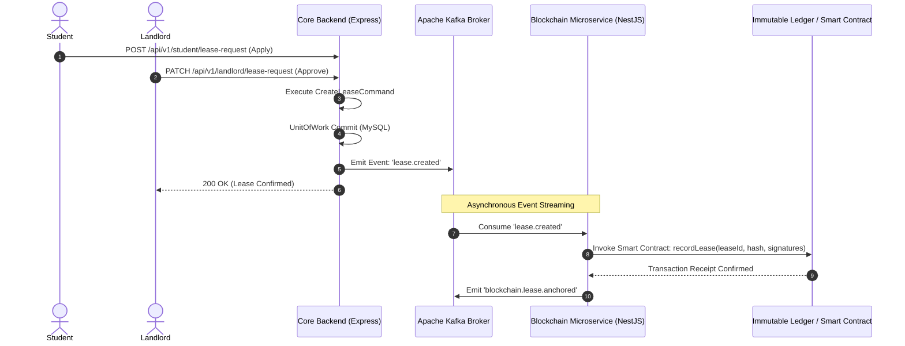

# Event-Driven Architecture & Blockchain Pipeline

**Project:** Student Nest (Bachelor of Science in Software Engineering Thesis)  
**Institution:** Middle East University (MEU) — Faculty of Information Technology  
**Department:** Software Engineering  

---

## 1. Architectural Motivation
In a multi-stakeholder real estate platform, critical actions—such as signing a lease, accepting a tenancy deposit, or resolving a dispute—must meet three stringent software requirements:
1. **Low Latency:** Client HTTP interactions must return immediately without waiting for slow consensus or distributed ledger writes.
2. **High Availability:** If the blockchain network or downstream microservice experiences downtime, core platform operations (searching apartments, chatting, submitting applications) must continue unabated.
3. **Immutability & Non-Repudiation:** Once a lease agreement is executed, its terms and signers cannot be unilaterally altered or erased by any party, including system administrators.

---

## 2. Event-Driven Topology with Apache Kafka

To satisfy these requirements, Student Nest employs an asynchronous, event-driven pipeline powered by **Apache Kafka 3.7.0**.

---

## 3. Core Implementation Details

### 3.1 Producer: KafkaMessageBroker (Core Service)
- Location: [`KafkaMessageBroker.service.ts`](file:///c:/Users/Ahmed/Desktop/projects/Student-Nest/student/Student-Nest/backend/service/core-service/src/Infrastructure/Services/messagine/KafkaMessageBroker.service.ts)
- Implementation: Thread-safe singleton using `kafkajs`. Handles connection pooling, topic creation, and guaranteed message delivery.

### 3.2 Consumer: Blockchain Service (NestJS Microservice)
- Location: [`backend/service/blockchain-service/`](file:///c:/Users/Ahmed/Desktop/projects/Student-Nest/student/Student-Nest/backend/service/blockchain-service/)
- Framework: NestJS `@nestjs/microservices` with Kafka transport.
- Subscribes to events across tenancy and payment domains to anchor tamper-proof proofs.

### 3.3 Containerization
Kafka and Kafka-UI are orchestrated via Docker Compose:
- Location: [`docker-compose.yml`](file:///c:/Users/Ahmed/Desktop/projects/Student-Nest/student/Student-Nest/backend/service/core-service/docker-compose.yml)
- Web UI accessible at port `8080` for monitoring topics, consumer groups, partitions, and message lag.
