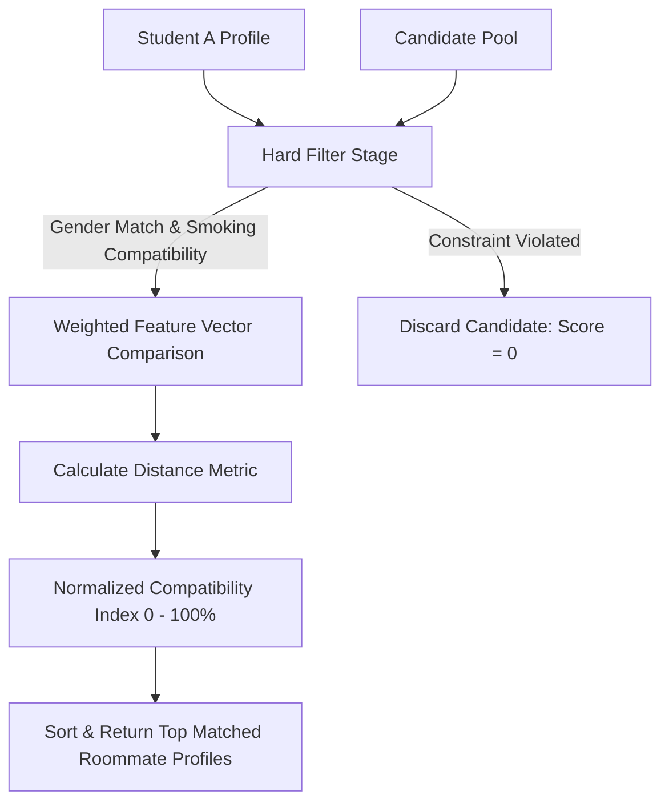

# Algorithmic Roommate Matching Model

**Project:** Student Nest (Bachelor of Science in Software Engineering Thesis)  
**Institution:** Middle East University (MEU) — Faculty of Information Technology  
**Department:** Software Engineering  

---

## 1. Overview
Finding compatible roommates is one of the most critical determinants of academic success and student well-being. Student Nest replaces subjective, ad-hoc roommate discovery with a structured, multi-dimensional lifestyle compatibility evaluation model.

---

## 2. Lifestyle Habit Feature Vectors
Each student profile contains an immutable lifestyle habit aggregate (`LifeCycleHabbitEntity`) defined across 9 discrete lifestyle dimensions:

| Dimension | Domain Enum | Values / Discrete Levels | Weight ($w_i$) |
|---|---|---|---|
| **Sleep Schedule** | `SleepSchedule` | Early Bird, Night Owl, Flexible | $0.20$ |
| **Noise Tolerance** | `NoiseTolerance` | Low (Quiet Study), Moderate, High (Social) | $0.15$ |
| **Smoking Habit** | `SmokingHabit` | Non-Smoker, Smoker, Balcony Only | $0.20$ (Hard Constraint) |
| **Pet Preference** | `PetPreference` | Loves Pets, No Pets, Hypoallergenic Only | $0.10$ |
| **Guest Policy** | `GuestPolicy` | Rare Guests, Weekends Only, Frequent Guests | $0.10$ |
| **Sharing Level** | `SharingLevel` | Independent, Moderate Sharing, Open Sharing | $0.10$ |
| **Dietary Preference** | `DietaryPreference` | Omnivore, Vegetarian, Vegan, Halal/Kosher | $0.05$ |
| **Primary Language** | `UserLanguage` | Arabic, English, Bilingual, Other | $0.05$ |
| **Age Range** | `AgeValue` | Target Age Gap (Min/Max Delta) | $0.05$ |

---

## 3. Compatibility Function Formulation

Let student $A$ and student $B$ be represented by their normalized habit vectors $\vec{v}_A$ and $\vec{v}_B$.

### 3.1 Hard Filtering (Zero-Tolerance Rules)
Certain attributes act as **hard filters**. If a hard constraint is violated, the compatibility score is automatically zero:
$$\text{Filter}(A, B) = \begin{cases} 0 & \text{if } A_{\text{gender}} \neq B_{\text{gender}} \\ 0 & \text{if } A_{\text{smoke}} = \text{Non-Smoker} \land B_{\text{smoke}} = \text{Indoor Smoker} \\ 1 & \text{otherwise} \end{cases}$$

### 3.2 Weighted Compatibility Metric
For candidates satisfying the hard filter, compatibility $C(A, B) \in [0, 100\%]$ is computed as the weighted Euclidean distance complement:

$$C(A, B) = 100 \times \left(1 - \sqrt{\sum_{i=1}^{n} w_i \cdot \left( \frac{\text{dist}(A_i, B_i)}{\text{max\_dist}_i} \right)^2}\right)$$

Where:
- $w_i$ is the normalized attribute weight ($\sum w_i = 1.0$).
- $\text{dist}(A_i, B_i)$ measures categorical or numerical divergence between habits.

---

## 4. Query Handler Implementation
The matching logic is encapsulated in the Application Layer:
- Query: [`GetRoommateProfileThatMatchQueries.ts`](file:///c:/Users/Ahmed/Desktop/projects/Student-Nest/student/Student-Nest/backend/service/core-service/src/Application/BoundedContexts/RoommateProfile/Queries/GetRoommateProfileThatMatchQueries.ts)
- Query Handler: [`GetRoommatedProfileThatMatchedQueriesHandler.ts`](file:///c:/Users/Ahmed/Desktop/projects/Student-Nest/student/Student-Nest/backend/service/core-service/src/Application/BoundedContexts/RoommateProfile/QueriesHandler/GetRoommatedProfileThatMatchedQueriesHandler.ts)
- Aggregate Root: [`RommateProfile.aggregateRoot.ts`](file:///c:/Users/Ahmed/Desktop/projects/Student-Nest/student/Student-Nest/backend/service/core-service/src/Domain/BoundedContexts/RommateProfile/Aggregates/RommateProfile.aggregateRoot.ts)
